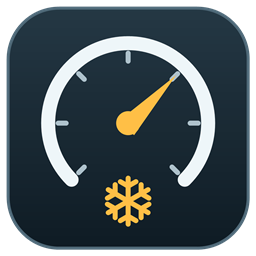

# SnowRunner Cruise control (SnowRunner CC) — standalone 1.0.1

Текущий релиз — **[standalone 1.0.1](https://github.com/TRSteep/SR_CruiseControl/releases/tag/standalone-v1.0.1)**. Полное название — SnowRunner Cruise control, сокращённое — SnowRunner CC. Имя `SnowRunnerCruiseControl.exe` и настройки `CruiseControl.ini` сохранены для совместимости. Версия хранится в `VERSION`.



Самостоятельный C#-проект. Иконка EXE и значок в трее изображают спидометр со снежинкой: янтарный акцент — круиз выключен, зелёный — включён, красный — ошибка ввода. Иконки встроены в EXE; дополнительные файлы изображений для запуска не нужны.

Утилита для Windows x64: переключатель удержания газа в SnowRunner. При включении отправляет нажатие физической W, при отключении — отпускание. Это полный газ, а не поддержание заданной скорости.

## Запуск

1. Запустите `dist\SnowRunnerCruiseControl.exe`. Установка и AutoHotkey не нужны. Требуется .NET Framework 4.x, обычно уже установленный в Windows 10/11.
2. Запустите SnowRunner и сядьте за руль. В настройках игры газ должен быть назначен на W, тормоз/задний ход — на S.
3. Нажмите **F6** — газ удерживается без удержания W.
4. Повторно нажмите **F6** или нажмите **W**, **S** либо **N** — круиз выключится. W передаёт газ под ручное управление до отпускания клавиши; S продолжает работать как тормоз, N — как переключатель двигателя.
5. Для завершения откройте значок утилиты в системном трее → **Выход**. Значок может находиться под стрелкой скрытых значков.

Утилита работает только при активном окне процесса `SnowRunner.exe`. При Alt+Tab, сворачивании, закрытии игры или штатном выходе из утилиты газ отпускается. После возврата в игру нужно включить круиз заново. Удержание F6 не вызывает повторных переключений. Комбинации с Ctrl/Alt/Shift/Win не активируют круиз. Повторный запуск не создаёт вторую копию.

Дополнительно круиз выключается при Esc, Enter, M, F1 и F4, чтобы сбросить газ при открытии распространённых экранов. Смена фокуса проверяется каждые 25 мс; фактическая задержка зависит от Windows. Отпускание W вручную не сбрасывает активный круиз.

## Клавиша переключения

По умолчанию выбрана **F6**. Проверьте её в настройках управления: персональные назначения, другие моды и оверлеи могут занимать эту клавишу. Если она занята, выберите другую свободную функциональную клавишу.

Измените файл **рядом с EXE**, `dist\CruiseControl.ini`, и перезапустите утилиту:

```ini
[CruiseControl]
ToggleKey=F7
```

Поддерживаются F2–F12, кроме F4. Выбранная клавиша перехватывается в активном окне игры и не поступает в саму игру. Физические W/S/N определяются по scan code, поэтому переключение русской и английской раскладки не меняет их работу.

## Ограничения и проверка в игре

Это внешняя утилита ввода, а не пакет для браузера модов/mod.io: запустите EXE отдельно, менять файлы игры не нужно. Она не читает память игры и не определяет, открыт ли внутриигровой экран. Не включайте круиз в меню или чате; отключайте его перед переходом в экран мышью либо нестандартной клавишей. Сброс по W/S/N относится к клавиатуре; тормоз с геймпада или руля не отслеживается. N сбрасывает круиз при любом нажатии, включая запуск двигателя; выключение двигателя через меню или другое назначение клавиши не отслеживается.

В текущем окружении проверены сборка, логика состояний и запуск обработчика клавиатуры. Работа внутри SnowRunner ещё требует проверки на вашей установленной версии игры:

- На безопасном участке нажмите F6: машина должна ехать без удержания W. Зажмите F6 на секунду: состояние должно измениться один раз.
- Нажмите F6 ещё раз: газ должен отпуститься.
- Включите снова и нажмите S: газ должен отпуститься, а тормоз — сработать. F6 при зажатой S не должен включать газ.
- При активном круизе нажмите W: круиз должен выключиться, а газ — работать вручную до отпускания W.
- Включите круиз снова и нажмите N: круиз и двигатель должны выключиться, газ не должен оставаться нажатым.
- Переключитесь в другое окно и вернитесь: круиз должен остаться выключенным.
- В русской раскладке повторите проверку W, S и N по их физическому расположению.

Если игра не принимает ввод, проверьте назначение W/S. Если SnowRunner запущен от администратора, утилите тоже нужны такие же права: Windows ограничивает SendInput по уровню прав. При ошибке ввода статус в трее сообщит об этом. Неудавшееся отпускание повторяется таймером. Не завершайте утилиту принудительно через диспетчер задач во время удержания газа: код очистки в таком случае не выполняется; если газ остался нажатым, нажмите и отпустите W.

## Сборка из исходников

В PowerShell из папки `standalone`:

```powershell
powershell -NoProfile -ExecutionPolicy Bypass -File .\build.ps1
```

Используется системный компилятор .NET Framework, без загрузки пакетов. Скрипт создаёт EXE и запускает проверки состояний. Настроенный файл INI в `dist` при повторной сборке сохраняется. Для переноса на другой компьютер достаточно `SnowRunnerCruiseControl.exe`, `CruiseControl.ini` и этой инструкции из `dist`.

`assets/GenerateIcons.cs` — исходник векторного рисунка и генератора ICO. Сборка создаёт три варианта иконки с размерами 16, 20, 24, 32, 40, 48, 64, 128 и 256 пикселей, встраивает их в EXE и задаёт иконку приложения. Промежуточные файлы находятся в `build`.

Техническая основа: [SendInput](https://learn.microsoft.com/en-us/windows/win32/api/winuser/nf-winuser-sendinput) и [LowLevelKeyboardProc](https://learn.microsoft.com/en-us/windows/win32/winmsg/lowlevelkeyboardproc), документация Microsoft. Искусственный ввод игнорируется обработчиком, а W/S/N не блокируются.
